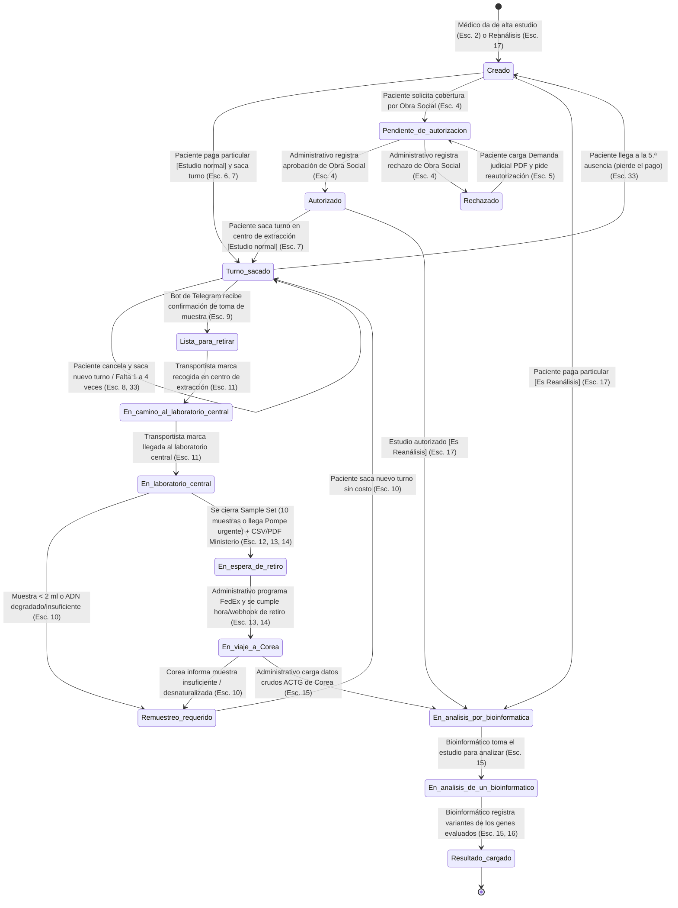
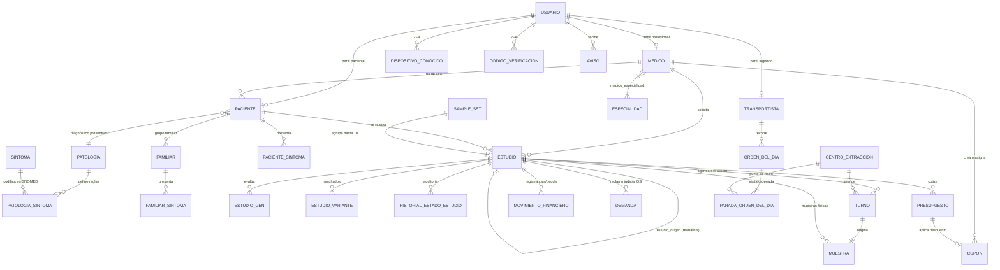

# Especificación 01: Modelo de Dominio y Máquina de Estados

> **Fuente de verdad:** [1-Entrevista.md](../../.ai/1-Entrevista.md), [2-Glosario_LEL.md](../../.ai/2-Glosario_LEL.md), [3-Escenarios.md](../../.ai/3-Escenarios.md) y [Prototipo.pdf](../../.ai/Prototipo.pdf).  
> **Convención:** Todos los nombres de entidades, atributos, estados y servicios respetan estrictamente el vocabulario en español del Glosario LEL.

---

## 1. Sujetos del Sistema (Roles y Permisos)

El sistema contempla **7 sujetos (roles)** autenticados y **1 actor externo automatizado** (Centro de extracción vía Bot de Telegram):

| Rol (`EnumRolUsuario`) | Nombre en LEL | Forma de Alta | Permisos Principales |
| :--- | :--- | :--- | :--- |
| `ADMIN_GENERAL` | **Admin general** | Preexistente / Seed inicial | Da de alta a los **gerentes médicos** (Esc. 31). |
| `GERENTE_MEDICO` | **Gerente médico** | Alta por `ADMIN_GENERAL` | Crea **cupones**, los asigna a **médicos**, da de alta y modifica **patologías** y sus **síntomas cardinales/secundarios** (Esc. 23, 29, 31). Posee también las facultades de `MEDICO`. |
| `MEDICO` | **Médico** (tratante / derivante) | Auto-registro (matrícula, especialidades, datos personales) | Da de alta **pacientes** y **familiares**, graba **historia clínica**, carga **síntomas SNOMED**, da de alta **estudios**, asigna **cupones** a pacientes y solicita **reanálisis** (Esc. 1, 2, 17, 18, 19, 21, 30, 35, 36). |
| `PACIENTE` | **Paciente** (o padre/tutor si es menor) | Creado por el `MEDICO` en la consulta inicial | Cambia su **contraseña inicial**, paga el **presupuesto** (aplicando **cupón**) o solicita cobertura por **obra social**, sube **demanda** judicial en rechazos, saca/cancela **turno**, sigue su **muestra** en el mapa, descarga el **resultado** y consulta al **chatbot** (Esc. 5, 6, 7, 8, 16, 20, 25, 30, 32, 33, 37). |
| `ADMINISTRATIVO` | **Administrativo** (Lab. Central) | Auto-registro (nombre, apellido, teléfono, mail) | Emite el **presupuesto**, registra autorización o rechazo de **obra social**, coordina el **retiro** de **sample sets** con **FedEx**, registra volumen/estado de muestras y carga los **datos crudos** recibidos de Corea (Esc. 3, 4, 5, 10, 13, 14, 22). |
| `TRANSPORTISTA` | **Transportista** (1 por provincia) | Alta administrativa / Seed | Recibe la **orden del día** optimizada (sin poder modificarla), marca la **recogida** de muestras en cada **centro de extracción** y marca la llegada al **laboratorio central** (Esc. 11, 32). |
| `BIOINFORMATICO` | **Bioinformático** | Auto-registro / Alta de equipo (comparten mail de aviso) | Visualiza la cola de estudios en `En análisis por bioinformática` (con prioridad en **Pompe urgente**), toma un estudio (`En análisis de un bioinformático`), consulta la **API de bioinformática** y carga las **variantes** encontradas generando el **resultado** (Esc. 15, 16, 24). |

> **Regla estricta de dominio (LEL):** Ningún usuario (`Administrativo`, `Bioinformático`, `Médico`, `Paciente`, etc.) puede darse de baja ni borrar su información del sistema.

---

## 2. Máquina de Estados del Estudio (`EnumEstadoEstudio`)

Todo **Estudio** transita por un circuito gobernado por los **14 estados** definidos en [2-Glosario_LEL.md](../../.ai/2-Glosario_LEL.md#L647-L770).

### 2.1. Diagrama de Transición de Estados

### 2.2. Catálogo de los 14 Estados y Reglas de Transición

| # | Código Interno (`EnumEstadoEstudio`) | Nombre Exacto en LEL | Estado Origen Permitido | Evento Disparador y Actor | Efectos Secundarios |
| :-: | :--- | :--- | :--- | :--- | :--- |
| 1 | `CREADO` | **Creado** | *(Inicial)* o `TURNO_SACADO` | `MEDICO` crea el estudio (o `SISTEMA` al 5.º ausente). | Habilita al `ADMINISTRATIVO` a emitir el **presupuesto**. Si vuelve desde `TURNO_SACADO` por 5 ausencias, invalida el pago anterior. |
| 2 | `PENDIENTE_DE_AUTORIZACION` | **Pendiente de autorización** | `CREADO`, `RECHAZADO` | `PACIENTE` elige financiar por **obra social**, o sube **demanda** judicial tras rechazo. | Genera **aviso** para que el `ADMINISTRATIVO` gestione y cargue la resolución de la obra social. |
| 3 | `AUTORIZADO` | **Autorizado** | `PENDIENTE_DE_AUTORIZACION` | `ADMINISTRATIVO` registra que la **obra social** autorizó el estudio. | Se asume pagado. Registra el movimiento financiero, notifica al `PACIENTE` y habilita **sacar turno** (o pasa a `EN_ANALISIS_POR_BIOINFORMATICA` si es **reanálisis**). |
| 4 | `RECHAZADO` | **Rechazado** | `PENDIENTE_DE_AUTORIZACION` | `ADMINISTRATIVO` registra el rechazo de la **obra social** con su motivo. | Habilita al `PACIENTE` a cargar una **demanda** (PDF judicial favorable) o pasar a pago particular. |
| 5 | `TURNO_SACADO` | **Turno sacado** | `CREADO` (tras pago), `AUTORIZADO`, `REMUESTREO_REQUERIDO`, `TURNO_SACADO` | `PACIENTE` selecciona un **centro de extracción** y confirma un **turno** libre. | Envía por mail y genera en sistema: **orden de extracción** (sin ayuno), **consentimiento informado** y **recordatorio** (informando límite de 5 ausencias). |
| 6 | `LISTA_PARA_RETIRAR` | **Lista para retirar** | `TURNO_SACADO` | `BOT_TELEGRAM` recibe el mensaje del **centro de extracción** confirmando la toma de la **muestra**. | Marca el turno como asistido y deja la **muestra** elegible para la próxima **orden del día** del `TRANSPORTISTA` de esa provincia. |
| 7 | `EN_CAMINO_AL_LABORATORIO_CENTRAL` | **En camino al laboratorio central** | `LISTA_PARA_RETIRAR` | `TRANSPORTISTA` marca la **recogida** en el **centro de extracción**. | Habilita la visualización de la posición en el **mapa de seguimiento** del `PACIENTE`. |
| 8 | `EN_LABORATORIO_CENTRAL` | **En laboratorio central** | `EN_CAMINO_AL_LABORATORIO_CENTRAL` | `TRANSPORTISTA` marca la llegada al **laboratorio central**. | Si la muestra es válida ($\ge 2\text{ ml}$), el sistema la agrega automáticamente al **sample set** abierto. |
| 9 | `REMUESTREO_REQUERIDO` | **Remuestreo requerido** | `EN_LABORATORIO_CENTRAL`, `EN_VIAJE_A_COREA` | `ADMINISTRATIVO` / laboratorio registra volumen $< 2\text{ ml}$ o ADN desnaturalizado/insuficiente. | No tiene costo para el paciente. Reinicia el contador de ausencias del tramo, notifica por mail/aviso a `PACIENTE` y `MEDICO` y habilita **sacar turno**. |
| 10 | `EN_ESPERA_DE_RETIRO` | **En espera de retiro** | `EN_LABORATORIO_CENTRAL` | `SISTEMA` cierra el **sample set** al llegar a 10 muestras o ingresar un **Pompe urgente**. | Genera automáticamente el **CSV** de pacientes, lo envía a la **API del Ministerio de Salud**, asocia el PDF de **autorización del Ministerio** y habilita programar **FedEx**. |
| 11 | `EN_VIAJE_A_COREA` | **En viaje a Corea** | `EN_ESPERA_DE_RETIRO` | `ADMINISTRATIVO` programa día, hora y URL con **FedEx** y se ejecuta el webhook/hora de retiro. | Cambia el estado del **sample set** y de todos sus **estudios** a `En viaje a Corea`. |
| 12 | `EN_ANALISIS_POR_BIOINFORMATICA` | **En análisis por bioinformática** | `EN_VIAJE_A_COREA` (o `CREADO`/`AUTORIZADO` en Reanálisis) | `ADMINISTRATIVO` carga el archivo de **datos crudos** (ACTG) enviado desde Corea (o pago/autorización de un **reanálisis**). | Envía mail de aviso al correo compartido del equipo de **bioinformática**. Ordena la cola priorizando **Pompe urgente** primero y luego por orden de llegada. |
| 13 | `EN_ANALISIS_DE_UN_BIOINFORMATICO` | **En análisis de un bioinformático** | `EN_ANALISIS_POR_BIOINFORMATICA` | `BIOINFORMATICO` toma el estudio para analizarlo. | Asigna el estudio al `BIOINFORMATICO` para evitar trabajo duplicado en el equipo. |
| 14 | `RESULTADO_CARGADO` | **Resultado cargado** | `EN_ANALISIS_DE_UN_BIOINFORMATICO` | `BIOINFORMATICO` selecciona las **variantes** para los **genes** del estudio y confirma el resultado. | Determina positividad (positivo si $\ge 1$ variante es `PATOGENICA`), genera el PDF de **resultado** y envía mail y **aviso** al `MEDICO` y al `PACIENTE`. |

---

## 3. Diagrama Entidad-Relación (DER)

---

## 4. Especificación de Tablas y Entidades (`app/models/`)

### 4.1. Módulo de Identidad, Seguridad y Catálogos

#### `usuarios` (`Usuario`)
* `id`: `UUID` / `BigInt` (PK)
* `email`: `String(255)` (Unique, Not Null, Index)
* `password_hash`: `String(255)` (Not Null)
* `rol`: `EnumRolUsuario` (`ADMIN_GENERAL`, `GERENTE_MEDICO`, `MEDICO`, `PACIENTE`, `ADMINISTRATIVO`, `TRANSPORTISTA`, `BIOINFORMATICO`) (Not Null)
* `nombre`: `String(120)` (Not Null)
* `apellido`: `String(120)` (Not Null)
* `telefono`: `String(50)` (Not Null)
* `requiere_cambio_password`: `Boolean` (Default `False`; `True` al crear un `PACIENTE` o `GERENTE_MEDICO` hasta su primer ingreso - Esc. 20)
* `creado_en`: `DateTime(timezone=True)` (Not Null)

#### `dispositivos_conocidos` (`DispositivoConocido`) y `codigos_verificacion` (`CodigoVerificacion`)
* Soportan los Escenarios 26 y 27:
  * `DispositivoConocido`: `id` (PK), `usuario_id` (FK `usuarios.id`), `huella_dispositivo` (`String(255)`), `ip_ultimo_acceso` (`String(64)`), `registrado_en` (`DateTime`).
  * `CodigoVerificacion`: `id` (PK), `usuario_id` (FK `usuarios.id`), `huella_dispositivo` (`String(255)`), `codigo` (`String(6)`), `expira_en` (`DateTime`), `usado` (`Boolean`, Default `False`).

#### `medicos` (`Medico`) y `especialidades` (`Especialidad`)
* `Medico`:
  * `id` (PK), `usuario_id` (FK `usuarios.id`, Unique, Not Null)
  * `matricula`: `String(64)` (Unique, Not Null; se asume válida sin consulta externa según LEL)
  * `es_gerente_medico`: `Boolean` (Not Null, Default `False`)
* `Especialidad`:
  * `id` (PK), `nombre`: `String(120)` (Unique, Not Null; catálogo estandarizado completo)
* Tabla intermedia `medico_especialidad` (`medico_id`, `especialidad_id`).

#### `transportistas` (`Transportista`)
* `id` (PK), `usuario_id` (FK `usuarios.id`, Unique, Not Null)
* `provincia`: `String(100)` (Unique, Not Null; existe exactamente 1 transportista por provincia según LEL).

#### `patologias` (`Patologia`), `sintomas` (`Sintoma`) y `patologia_sintomas` (`PatologiaSintoma`)
* `Patologia`:
  * `id` (PK)
  * `codigo`: `String(32)` (Unique, Not Null: `FABRY`, `POMPE`, `MPS_I`, `GAUCHER`, `ASMD`)
  * `nombre`: `String(120)` (Not Null: Enfermedad de Fabry, Enfermedad de Pompe, Mucopolisacaridosis I, Enfermedad de Gaucher, ASMD)
  * `actualizado_por_id`: `FK medicos.id` (Nullable; modificado por `GERENTE_MEDICO` - Esc. 23)
* `Sintoma`:
  * `id` (PK)
  * `codigo_snomed`: `String(64)` (Unique, Not Null)
  * `termino`: `String(255)` (Not Null)
* `PatologiaSintoma`:
  * `id` (PK), `patologia_id` (FK `patologias.id`), `sintoma_id` (FK `sintomas.id`)
  * `tipo_sintoma`: `EnumTipoSintoma` (`CARDINAL`, `SECUNDARIO`) (Not Null)
  * *Restricción:* Una patología tiene un `Síntoma cardinal` y múltiples `Síntomas secundarios`.

---

### 4.2. Módulo de Pacientes e Información Familiar

#### `pacientes` (`Paciente`)
* `id` (PK)
* `usuario_id`: `FK usuarios.id` (Unique, Not Null)
* `medico_tratante_id`: `FK medicos.id` (Not Null; médico derivante que lo dio de alta)
* `dni`: `String(20)` (Unique, Not Null, Index)
* `nombre`: `String(120)` (Not Null)
* `apellido`: `String(120)` (Not Null)
* `fecha_nacimiento`: `Date` (Not Null; si es menor de 18 años el padre opera la cuenta; si tiene $< 4\text{ meses}$ y la patología es `POMPE`, califica como **Pompe urgente**)
* `telefono`: `String(50)` (Not Null)
* `email`: `String(255)` (Not Null)
* `diagnostico_presuntivo_id`: `FK patologias.id` (Not Null)
* `tipo_sospecha`: `EnumTipoSospecha` (`CLINICA`, `FAMILIAR`) (Not Null)
* `historia_clinica`: `Text` (Not Null; cargada por texto o mediante el **transcriptor de audio** - Esc. 35)
* `sin_informacion_familiar`: `Boolean` (Not Null, Default `False` - Esc. 19)
* `familiograma_pdf_url`: `String(500)` (Nullable; PDF devuelto por la **API de familiograma** - Esc. 18)
* `creado_en`: `DateTime(timezone=True)` (Not Null)

> **Regla de validación en el alta de Paciente (Escenarios 1 y 36):**
> * Todos los campos son obligatorios salvo la sección familiar (`familiares` / `familiograma_pdf_url`).
> * Si `tipo_sospecha == CLINICA`: los síntomas seleccionados en `paciente_sintomas` deben incluir **al menos 1 síntoma cardinal** o **al menos 2 síntomas secundarios** asociados a `diagnostico_presuntivo_id`. Si no se cumple, se rechaza el alta (`422 Unprocessable Entity`).
> * Si `tipo_sospecha == FAMILIAR`: se permite dar de alta al paciente incluso sin síntomas (`0` síntomas), dado que acude por antecedente genético familiar.

#### `familiares` (`Familiar`) y `familiar_sintomas` (`FamiliarSintoma`)
* `Familiar`:
  * `id` (PK), `paciente_id` (FK `pacientes.id`, Not Null)
  * `parentesco`: `String(64)` (Not Null; ej. Padre, Madre, Hermano/a, Primo/a, Abuelo/a, Tío/a)
  * `nombre`: `String(120)` (Not Null)
  * `diagnostico_previo_patologia_id`: `FK patologias.id` (Nullable; indica si ya tiene diagnóstico confirmado de alguna de las 5 patologías)
* `FamiliarSintoma`:
  * `familiar_id` (FK `familiares.id`), `sintoma_id` (FK `sintomas.id`).

---

### 4.3. Módulo de Estudios, Genes y Variantes

#### `estudios` (`Estudio`)
* `id` (PK)
* `codigo`: `String(32)` (Unique, Not Null; ej. `EC-0001`)
* `paciente_id`: `FK pacientes.id` (Not Null)
* `medico_id`: `FK medicos.id` (Not Null)
* `patologia_sospechada_id`: `FK patologias.id` (Not Null)
* `estado`: `EnumEstadoEstudio` (Not Null, Default `CREADO`)
* `incluye_hallazgos_secundarios`: `Boolean` (Not Null, Default `False`)
* `es_pompe_urgente`: `Boolean` (Not Null, Default `False`; `True` si `patologia_sospechada.codigo == 'POMPE'` y la edad del paciente es $< 4\text{ meses}$)
* `es_reanalisis`: `Boolean` (Not Null, Default `False` - Esc. 17)
* `estudio_origen_id`: `FK estudios.id` (Nullable; obligatorio cuando `es_reanalisis == True`, apunta al estudio que ya posee los `datos_crudos_actg`)
* `cantidad_ausencias_turno`: `Integer` (Not Null, Default `0`; al llegar a `5` ausencias, el estudio vuelve a `CREADO` y el paciente pierde el pago - Esc. 33)
* `sample_set_id`: `FK sample_sets.id` (Nullable)
* `datos_crudos_actg`: `Text` / `String(500)` (Nullable; secuencia ACTG o archivo cargado por el `ADMINISTRATIVO` al recibir de Corea)
* `bioinformatico_id`: `FK usuarios.id` (Nullable; bioinformático que tomó el estudio en `EN_ANALISIS_DE_UN_BIOINFORMATICO`)
* `resultado_diagnostico`: `EnumResultadoDiagnostico` (`POSITIVO`, `NEGATIVO`, Nullable; `POSITIVO` si se registra al menos una variante `PATOGENICA`)
* `resultado_pdf_url`: `String(500)` (Nullable)
* `creado_en`, `actualizado_en`: `DateTime(timezone=True)`

#### `estudio_genes` (`EstudioGen`)
* `id` (PK), `estudio_id` (FK `estudios.id`, Not Null)
* `simbolo_gen`: `String(64)` (Not Null; ej. `GLA`, `GAA`, `IDUA`, `GBA`, `SMPD1`)
* `origen`: `EnumOrigenGen` (`PATOLOGIA`, `HALLAZGO_SECUNDARIO`, `MANUAL`) (Not Null)
* *Restricción:* `(estudio_id, simbolo_gen)` es único.

#### `estudio_variantes` (`EstudioVariante`)
* `id` (PK), `estudio_id` (FK `estudios.id`, Not Null), `estudio_gen_id` (FK `estudio_genes.id`, Not Null)
* `simbolo_gen`: `String(64)` (Not Null)
* `identificador_variante`: `String(120)` (Not Null; ej. `c.644A>G`)
* `proteina`: `String(120)` (Nullable; ej. `p.Asn215Ser`)
* `clasificacion`: `EnumClasificacionVariante` (`PATOGENICA`, `BENIGNA`, `INOCUA`, `VUS`) (Not Null; provista por la **API de bioinformática**)

---

### 4.4. Módulo de Presupuesto, Obras Sociales, Cupones y Finanzas

#### `presupuestos` (`Presupuesto`)
* `id` (PK)
* `numero`: `String(32)` (Unique, Not Null; ej. `P-0001`)
* `estudio_id`: `FK estudios.id` (Not Null)
* `emitido_por_id`: `FK usuarios.id` (Not Null; rol `ADMINISTRATIVO`)
* `cantidad_genes`: `Integer` (Not Null; total de genes en `estudio_genes`)
* `monto_base_usd`: `Numeric(10, 2)` (Not Null, fijo en `500.00` hasta 5 genes)
* `monto_genes_adicionales_usd`: `Numeric(10, 2)` (Not Null; $\max(0, \text{cantidad\_genes} - 5) \times 30.00$)
* `monto_subtotal_usd`: `Numeric(10, 2)` (Not Null; `monto_base_usd + monto_genes_adicionales_usd`)
* `modalidad`: `EnumModalidadPago` (`SIN_DEFINIR`, `PARTICULAR`, `OBRA_SOCIAL`) (Not Null, Default `SIN_DEFINIR`)
* `obra_social_nombre`: `String(120)` (Nullable; seleccionada de la **API de obras sociales**)
* `porcentaje_cobertura_os`: `Numeric(5, 2)` (Not Null, Default `0.00`)
* `monto_cubierto_os_usd`: `Numeric(10, 2)` (Not Null, Default `0.00`)
* `cupon_id`: `FK cupones.id` (Nullable; se acumula con la cobertura de la obra social según LEL)
* `monto_descuento_cupon_usd`: `Numeric(10, 2)` (Not Null, Default `0.00`)
* `monto_a_pagar_paciente_usd`: `Numeric(10, 2)` (Not Null)
* `numero_autorizacion_os`: `String(64)` (Nullable)
* `motivo_rechazo_os`: `Text` (Nullable)
* `activo`: `Boolean` (Not Null, Default `True`; pasa a `False` si el paciente pierde el pago por 5 ausencias y requiere abonar nuevamente)
* `creado_en`: `DateTime(timezone=True)`

#### `cupones` (`Cupon`)
* `id` (PK)
* `codigo`: `String(64)` (Unique, Not Null; generado por la **API de cupones** - Esc. 29)
* `porcentaje_descuento`: `Numeric(5, 2)` (Not Null)
* `qr_pdf_url`: `String(500)` (Nullable)
* `creado_por_gerente_id`: `FK medicos.id` (Not Null; `GERENTE_MEDICO`)
* `medico_asignado_id`: `FK medicos.id` (Nullable; médico al que el gerente médico le asignó el cupón)
* `paciente_asignado_id`: `FK pacientes.id` (Nullable; paciente al que el médico le entregó el cupón - Esc. 30)
* `usado`: `Boolean` (Not Null, Default `False`; al aplicarse se notifica a la **API de cupones** para su vencimiento)
* `usado_en`: `DateTime(timezone=True)` (Nullable)

#### `demandas` (`Demanda`)
* `id` (PK), `estudio_id` (FK `estudios.id`, Not Null), `paciente_id` (FK `pacientes.id`, Not Null)
* `documento_judicial_pdf_url`: `String(500)` (Not Null; fallo judicial favorable en PDF - Esc. 5)
* `creado_en`: `DateTime(timezone=True)` (Not Null)

#### `movimientos_financieros` (`MovimientoFinanciero`)
* Registra todas las operaciones para el futuro tablero de control gerencial (caja y deuda por obra social y por paciente):
* `id` (PK), `estudio_id` (FK `estudios.id`, Not Null), `presupuesto_id` (FK `presupuestos.id`, Not Null), `paciente_id` (FK `pacientes.id`, Not Null)
* `obra_social_nombre`: `String(120)` (Nullable)
* `concepto`: `EnumConceptoFinanciero` (`PAGO_PARTICULAR`, `AUTORIZACION_OBRA_SOCIAL`, `SALDO_PACIENTE_OS`, `PERDIDA_PAGO_POR_AUSENCIAS`)
* `monto_usd`: `Numeric(10, 2)` (Not Null)
* `estado_contable`: `EnumEstadoContable` (`PAGADO`, `DEUDA_PENDIENTE`, `CONSOLIDADO_POR_PENALIDAD`)
* `creado_en`: `DateTime(timezone=True)` (Not Null)

---

### 4.5. Módulo de Turnos, Extracción, Logística y Envío a Corea

#### `centros_extraccion` (`CentroExtraccion`) y `feriados` (`Feriado`)
* `CentroExtraccion`:
  * `id` (PK), `nombre` (`String(150)`), `direccion` (`String(255)`), `provincia` (`String(100)`), `latitud` (`Float`), `longitud` (`Float`), `activo` (`Boolean`, Default `True`).
  * *Regla:* 100 centros tercerizados en el país; operan de lunes a viernes de 09:00 a 18:00 hs (turnos cada 15 minutos, 1 persona por turno).
* `Feriado`:
  * `fecha`: `Date` (PK), `descripcion`: `String(150)`. Bloquea turnos de extracción y generación de `OrdenDelDia`.

#### `turnos` (`Turno`)
* `id` (PK)
* `codigo`: `String(32)` (Unique, Not Null; ej. `T-2026-0148`)
* `estudio_id`: `FK estudios.id` (Not Null)
* `paciente_id`: `FK pacientes.id` (Not Null)
* `centro_extraccion_id`: `FK centros_extraccion.id` (Not Null)
* `fecha`: `Date` (Not Null)
* `hora_inicio`: `Time` (Not Null; valores válidos: `09:00`, `09:15`, ..., `17:45`)
* `estado`: `EnumEstadoTurno` (`CONFIRMADO`, `CANCELADO`, `FINALIZADO_ASISTIO`, `AUSENTE`) (Not Null, Default `CONFIRMADO`)
* `orden_extraccion_url`: `String(500)` (Not Null; aclara que **no requiere ayuno**)
* `consentimiento_informado_url`: `String(500)` (Not Null; para imprimir y firmar por paciente o padre/tutor)
* *Restricción de unicidad:* Solo puede existir un turno en estado `CONFIRMADO` para la tupla `(centro_extraccion_id, fecha, hora_inicio)`.

#### `muestras` (`Muestra`)
* `id` (PK)
* `estudio_id`: `FK estudios.id` (Not Null)
* `turno_id`: `FK turnos.id` (Not Null)
* `centro_extraccion_id`: `FK centros_extraccion.id` (Not Null)
* `fecha_hora_extraccion`: `DateTime(timezone=True)` (Not Null; registrada al recibir el mensaje del **Bot de Telegram**)
* `volumen_ml`: `Numeric(4, 2)` (Nullable; cargado al controlarse el tubo en el laboratorio central; si $< 2.00\text{ ml}$ se rechaza y dispara `Remuestreo requerido`)
* `adn_suficiente`: `Boolean` (Nullable; `False` si se desnaturalizó o no alcanza el ADN)
* `motivo_remuestreo`: `String(255)` (Nullable; ej. `Volumen insuficiente (< 2 ml)` o `ADN insuficiente / muestra degradada`)
* `parada_orden_dia_id`: `FK paradas_orden_del_dia.id` (Nullable)
* `sample_set_id`: `FK sample_sets.id` (Nullable)

#### `ordenes_del_dia` (`OrdenDelDia`) y `paradas_orden_del_dia` (`ParadaOrdenDelDia`)
* `OrdenDelDia`:
  * `id` (PK), `transportista_id` (FK `transportistas.id`, Not Null), `provincia` (`String(100)`), `fecha` (`Date`, Not Null; solo días hábiles lunes a viernes)
  * `estado`: `EnumEstadoOrdenDia` (`GENERADA`, `EN_CURSO`, `FINALIZADA_EN_LAB_CENTRAL`)
  * `fecha_hora_llegada_lab_central`: `DateTime(timezone=True)` (Nullable)
* `ParadaOrdenDelDia`:
  * `id` (PK), `orden_del_dia_id` (FK `ordenes_del_dia.id`, Not Null), `centro_extraccion_id` (FK `centros_extraccion.id`, Not Null)
  * `orden_visita`: `Integer` (Not Null; secuencia óptima calculada por la **API de optimización de recorridos**, inmodificable por el transportista)
  * `recogida_marcada`: `Boolean` (Not Null, Default `False`)
  * `fecha_hora_recogida`: `DateTime(timezone=True)` (Nullable)

#### `sample_sets` (`SampleSet`)
* `id` (PK)
* `codigo`: `String(32)` (Unique, Not Null; ej. `SS-2026-018`)
* `estado`: `EnumEstadoSampleSet` (`ABIERTO`, `EN_ESPERA_DE_RETIRO`, `EN_VIAJE_A_COREA`) (Not Null, Default `ABIERTO`)
* `cantidad_muestras`: `Integer` (Not Null, Default `0`, máximo `10`)
* `cerrado_por_pompe_urgente`: `Boolean` (Not Null, Default `False`)
* `csv_pacientes_url`: `String(500)` (Nullable; generado automáticamente al cerrarse el lote)
* `autorizacion_ministerio_pdf_url`: `String(500)` (Nullable; devuelto automáticamente por la **API del Ministerio de Salud**)
* `fedex_fecha_retiro`: `Date` (Nullable; lunes a viernes)
* `fedex_hora_retiro`: `Time` (Nullable; entre 09:00 y 18:00 hs)
* `fedex_webhook_url`: `String(500)` (Nullable; URL de callback enviada a FedEx para impactar el paso a `EN_VIAJE_A_COREA`)
* `cerrado_en`, `retirado_en`: `DateTime(timezone=True)` (Nullable)

> **Regla de negocio de cierre de `SampleSet` (Escenarios 12, 13 y 14):**
> 1. Cuando el `TRANSPORTISTA` marca la llegada al laboratorio central, cada muestra válida ($\ge 2\text{ ml}$) se incorpora al `SampleSet` en estado `ABIERTO`.
> 2. Si el `SampleSet` alcanza **10 muestras**, o si alguna de las muestras ingresadas corresponde a un **Pompe urgente** (enfermedad de Pompe en menor de 4 meses), el `SampleSet` se **cierra inmediatamente** (con las muestras que tenga en ese instante, ej. 6 muestras si había 5 y entró el Pompe urgente).
> 3. Una vez cerrado, el `SampleSet` pasa a `EN_ESPERA_DE_RETIRO`, **no admite nuevas muestras**, genera el `CSV` y obtiene el PDF de **autorización del Ministerio**.

#### `avisos` (`Aviso`)
* `id` (PK)
* `usuario_id`: `FK usuarios.id` (Nullable; aviso dirigido a un usuario puntual)
* `rol_destino`: `EnumRolUsuario` (Nullable; para avisos grupales a `ADMINISTRATIVO` o `BIOINFORMATICO`)
* `estudio_id`: `FK estudios.id` (Nullable)
* `titulo`: `String(150)` (Not Null)
* `mensaje`: `Text` (Not Null)
* `leido`: `Boolean` (Not Null, Default `False`)
* `creado_en`: `DateTime(timezone=True)` (Not Null)
