# Diagrama Entidad-Relación (DER) – Sistema de Seguimiento de Estudios de Exoma Clínico

Este documento describe el modelo de datos relacional completo (39 tablas organizadas en 9 módulos de dominio) implementado en [`src/core/models/`](../../src/core/models/__init__.py) para **PostgreSQL**, junto con el detalle de sus relaciones, restricciones de integridad y recomendaciones de indexación.

---

## 1. DER Completo (Mermaid `erDiagram`)

```mermaid
erDiagram
    %% ==========================================
    %% 1. USUARIOS Y ACCESO
    %% ==========================================
    usuarios {
        int id PK
        varchar email UK " unique, index "
        varchar password_hash
        enum_Rol rol " index "
        varchar nombre
        varchar apellido
        varchar telefono
        boolean debe_cambiar_password " default false "
        datetime created_at
        datetime updated_at
    }

    dispositivos_conocidos {
        int id PK
        int usuario_id FK " ON DELETE CASCADE, UK(usuario_id, identificador) "
        varchar identificador " UK(usuario_id, identificador) "
        datetime ultimo_acceso
    }

    codigos_verificacion {
        int id PK
        int usuario_id FK " ON DELETE CASCADE "
        varchar codigo_hash
        varchar dispositivo_identificador
        datetime expira_en
        boolean usado " default false "
    }

    avisos {
        int id PK
        int usuario_id FK " ON DELETE CASCADE, index "
        varchar mensaje
        boolean leido " default false "
        enum_CanalAviso canal " default APP "
        boolean enviado " default false "
        datetime enviado_en " nullable "
        datetime created_at
    }

    %% ==========================================
    %% 2. PERFILES
    %% ==========================================
    especialidades {
        int id PK
        varchar nombre UK
    }

    medicos {
        int id PK
        int usuario_id FK,UK " ON DELETE CASCADE "
        varchar matricula UK
    }

    medicos_especialidades {
        int medico_id PK,FK " ON DELETE CASCADE "
        int especialidad_id PK,FK
    }

    transportistas {
        int id PK
        int usuario_id FK,UK " ON DELETE CASCADE "
        varchar provincia UK " uno por provincia "
    }

    pacientes {
        int id PK
        int usuario_id FK,UK " ON DELETE CASCADE "
        int medico_id FK " index (medico derivante) "
        varchar dni UK " unique, index "
        date fecha_nacimiento
        int diagnostico_presuntivo_id FK
        text historia_clinica
        varchar tipo_sospecha
        varchar familiograma_pdf_path " nullable "
        varchar responsable_nombre " nullable "
        varchar responsable_dni " nullable "
    }

    %% ==========================================
    %% 3. CLINICA
    %% ==========================================
    patologias {
        int id PK
        varchar nombre UK " Fabry, Pompe, MPS1, Gaucher, ASMD "
        text descripcion " nullable "
        datetime created_at
        datetime updated_at
    }

    sintomas {
        int id PK
        varchar snomed_id UK " unique, index "
        varchar descripcion " index "
    }

    patologias_sintomas {
        int patologia_id PK,FK " ON DELETE CASCADE "
        int sintoma_id PK,FK
        boolean es_cardinal " uq_un_cardinal_por_patologia WHERE es_cardinal "
    }

    pacientes_sintomas {
        int paciente_id PK,FK " ON DELETE CASCADE "
        int sintoma_id PK,FK
    }

    familiares {
        int id PK
        int paciente_id FK " ON DELETE CASCADE, index "
        varchar parentesco
        varchar nombre
        varchar diagnostico_previo " nullable "
    }

    familiares_sintomas {
        int familiar_id PK,FK " ON DELETE CASCADE "
        int sintoma_id PK,FK
    }

    genes {
        int id PK
        varchar simbolo UK " unique, index "
        varchar nombre " nullable "
        boolean es_hallazgo_secundario " default false "
    }

    patologias_genes {
        int patologia_id PK,FK " ON DELETE CASCADE "
        int gen_id PK,FK " ON DELETE CASCADE "
    }

    variantes {
        int id PK
        int gen_id FK " ON DELETE CASCADE, index, UK(gen_id, notacion) "
        varchar notacion " UK(gen_id, notacion) "
        varchar clinvar_id " nullable, index "
        enum_ClasificacionVariante clasificacion " patogenica, benigna, inocua, vus "
    }

    %% ==========================================
    %% 4. ESTUDIOS
    %% ==========================================
    estudios {
        int id PK
        int paciente_id FK " index "
        int medico_id FK " index "
        int patologia_sospechada_id FK
        enum_EstadoEstudio estado " index, 14 estados LEL "
        boolean quiere_hallazgos_secundarios " default false "
        int obra_social_id FK " nullable "
        boolean es_pompe_urgente " default false "
        int ausencias " default 0, CHECK 0..5 "
        datetime created_at
        datetime updated_at
    }

    estudios_genes {
        int estudio_id PK,FK " ON DELETE CASCADE "
        int gen_id PK,FK
        enum_OrigenGen origen " patologia, manual, hallazgo_secundario "
    }

    %% ==========================================
    %% 5. ECONOMIA
    %% ==========================================
    obras_sociales {
        int id PK
        varchar nombre UK
        varchar rnos UK " nullable "
        numeric porcentaje_cobertura " CHECK 0..100 "
    }

    cupones {
        int id PK
        varchar codigo UK
        varchar qr_url " nullable "
        numeric descuento_porcentaje " CHECK 0..100 "
        int gerente_id FK " medicos.id (creador) "
        int medico_id FK " nullable, medicos.id (asignado) "
        int paciente_id FK " nullable, pacientes.id (asignado) "
        boolean usado " default false "
        datetime usado_en " nullable "
        datetime vigente_hasta " nullable "
        datetime created_at
        datetime updated_at
    }

    presupuestos {
        int id PK
        int estudio_id FK,UK
        int emitido_por_id FK " usuarios.id (administrativo) "
        int cantidad_genes
        numeric monto_total_usd " 500 USD base + 30 USD/gen extra "
        datetime created_at
        datetime updated_at
    }

    pagos {
        int id PK
        int presupuesto_id FK " index "
        enum_TipoPago tipo " particular, obra_social "
        numeric monto_usd
        int cupon_id FK " nullable "
        numeric descuento_cupon_usd " default 0 "
        numeric cobertura_obra_social_usd " default 0 "
        boolean anulado " default false (true tras 5 ausencias) "
        datetime fecha
    }

    autorizaciones {
        int id PK
        int estudio_id FK " index "
        enum_ResultadoAutorizacion resultado " pendiente, autorizada, rechazada "
        int registrada_por_id FK " nullable, usuarios.id "
        int demanda_id FK " nullable (si es reautorizacion) "
        varchar solicitud_externa_id " nullable, index "
        datetime fecha
    }

    demandas {
        int id PK
        int estudio_id FK " index "
        varchar pdf_path
        datetime fecha
    }

    %% ==========================================
    %% 6. TURNOS
    %% ==========================================
    centros_extraccion {
        int id PK
        varchar nombre
        varchar direccion
        varchar provincia " index "
        float latitud
        float longitud
    }

    turnos {
        int id PK
        int centro_id FK " index, uq_turno_activo(centro_id, inicio) "
        int paciente_id FK " index "
        int estudio_id FK " index "
        datetime inicio " uq_turno_activo WHERE activo "
        boolean activo " default true "
        boolean asistio " nullable "
    }

    %% ==========================================
    %% 7. LOGISTICA Y TRANSPORTE
    %% ==========================================
    sample_sets {
        int id PK
        enum_EstadoSampleSet estado " abierto, cerrado, en_viaje_a_corea "
        datetime cerrado_en " nullable "
        boolean es_pompe_urgente " default false "
        varchar csv_path " nullable "
        varchar autorizacion_ministerio_pdf_path " nullable "
        datetime retiro_fedex_fecha " nullable "
        varchar retiro_fedex_lugar " nullable "
        varchar retiro_fedex_url " nullable "
        varchar retiro_fedex_pedido_id " nullable "
        datetime created_at
        datetime updated_at
    }

    muestras {
        int id PK
        int estudio_id FK " index "
        int turno_id FK " nullable "
        int sample_set_id FK " nullable, index "
        numeric mililitros " nullable (< 2ml -> descarte) "
        datetime tomada_en " nullable "
        datetime llegada_lab_central " nullable "
        enum_MotivoDescarte motivo_descarte " nullable "
        datetime created_at
        datetime updated_at
    }

    ordenes_del_dia {
        int id PK
        int transportista_id FK " index, UK(transportista_id, fecha) "
        date fecha " index, UK(transportista_id, fecha) "
    }

    ordenes_del_dia_paradas {
        int id PK
        int orden_id FK " ON DELETE CASCADE, UK(orden_id, posicion) "
        int centro_id FK
        int posicion " UK(orden_id, posicion) "
        datetime retirada_en " nullable "
        datetime llegada_lab_central " nullable "
    }

    posiciones_transporte {
        int id PK
        int orden_id FK " ON DELETE CASCADE, index "
        float latitud
        float longitud
        datetime registrada_en
    }

    %% ==========================================
    %% 8. ANALISIS BIOINFORMATICO Y RESULTADOS
    %% ==========================================
    datos_crudos {
        int id PK
        int estudio_id FK,UK
        int cargado_por_id FK " usuarios.id (administrativo) "
        varchar archivo_path
        datetime cargado_en
    }

    analisis {
        int id PK
        int estudio_id FK " index "
        enum_TipoAnalisis tipo " inicial, reanalisis "
        int bioinformatico_id FK " nullable, usuarios.id "
        int solicitado_por_id FK " nullable, medicos.id "
        datetime created_at
    }

    analisis_genes {
        int analisis_id PK,FK " ON DELETE CASCADE "
        int gen_id PK,FK
    }

    analisis_variantes {
        int analisis_id PK,FK " ON DELETE CASCADE "
        int variante_id PK,FK
    }

    resultados {
        int id PK
        int analisis_id FK,UK
        boolean positivo
        varchar pdf_path
        datetime generado_en
    }

    %% ==========================================
    %% 9. CONFIGURACION
    %% ==========================================
    configuracion {
        varchar clave PK
        varchar valor
    }

    %% ==========================================
    %% RELACIONES
    %% ==========================================
    %% Usuarios y Perfiles
    usuarios ||--o| pacientes : "perfil paciente (1:1)"
    usuarios ||--o| medicos : "perfil medico/gerente (1:1)"
    usuarios ||--o| transportistas : "perfil transportista (1:1)"
    usuarios ||--o{ dispositivos_conocidos : "ingresa desde"
    usuarios ||--o{ codigos_verificacion : "valida acceso"
    usuarios ||--o{ avisos : "recibe"

    medicos ||--o{ medicos_especialidades : "tiene"
    especialidades ||--o{ medicos_especialidades : "agrupa"
    medicos ||--o{ pacientes : "da de alta"

    %% Clinica
    patologias ||--o{ pacientes : "diagnostico presuntivo"
    patologias ||--o{ patologias_sintomas : "define"
    sintomas ||--o{ patologias_sintomas : "clasifica en"
    pacientes ||--o{ pacientes_sintomas : "presenta"
    sintomas ||--o{ pacientes_sintomas : "observado en"
    pacientes ||--o{ familiares : "tiene"
    familiares ||--o{ familiares_sintomas : "presenta"
    sintomas ||--o{ familiares_sintomas : "observado en"
    patologias ||--o{ patologias_genes : "asocia"
    genes ||--o{ patologias_genes : "vinculado a"
    genes ||--o{ variantes : "contiene"

    %% Estudios
    pacientes ||--o{ estudios : "se realiza"
    medicos ||--o{ estudios : "solicita"
    patologias ||--o{ estudios : "patologia sospechada"
    obras_sociales |o--o{ estudios : "cubre"
    estudios ||--o{ estudios_genes : "analiza"
    genes ||--o{ estudios_genes : "incluido en"

    %% Economia
    medicos ||--o{ cupones : "crea (gerente_id)"
    medicos |o--o{ cupones : "recibe (medico_id)"
    pacientes |o--o{ cupones : "asignado a (paciente_id)"
    estudios ||--o| presupuestos : "cotiza en (1:1)"
    usuarios ||--o{ presupuestos : "emite (administrativo)"
    presupuestos ||--o{ pagos : "registra"
    cupones |o--o{ pagos : "descuenta en"
    estudios ||--o{ autorizaciones : "gestiona"
    usuarios |o--o{ autorizaciones : "registra (administrativo)"
    demandas |o--o{ autorizaciones : "origina reautorizacion"
    estudios ||--o{ demandas : "reclama con"

    %% Turnos y Logistica
    centros_extraccion ||--o{ turnos : "agenda en"
    pacientes ||--o{ turnos : "reserva"
    estudios ||--o{ turnos : "requiere"
    estudios ||--o{ muestras : "extrae"
    turnos |o--o{ muestras : "origina"
    sample_sets |o--o{ muestras : "agrupa (max 10)"
    transportistas ||--o{ ordenes_del_dia : "recorre"
    ordenes_del_dia ||--o{ ordenes_del_dia_paradas : "visita"
    centros_extraccion ||--o{ ordenes_del_dia_paradas : "es parada en"
    ordenes_del_dia ||--o{ posiciones_transporte : "reporta GPS"

    %% Analisis Bioinformatico y Resultados
    estudios ||--o| datos_crudos : "recibe de Corea (1:1)"
    usuarios ||--o{ datos_crudos : "carga (administrativo)"
    estudios ||--o{ analisis : "procesa (inicial / reanalisis)"
    usuarios |o--o{ analisis : "ejecuta (bioinformatico)"
    medicos |o--o{ analisis : "solicita reanalisis"
    analisis ||--o{ analisis_genes : "evalua"
    genes ||--o{ analisis_genes : "evaluado en"
    analisis ||--o{ analisis_variantes : "detecta"
    variantes ||--o{ analisis_variantes : "hallada en"
    analisis ||--o| resultados : "emite (1:1)"
```



---

## 2. Resumen de Relaciones y Cardinalidades por Módulo

### 2.1 Usuarios y Perfiles ([`usuarios.py`](../../src/core/models/usuarios.py), [`perfiles.py`](../../src/core/models/perfiles.py))
| Origen | Destino | Cardinalidad | Clave Foránea / Tabla Intermedia | Regla de Integridad / Negocio |
| :--- | :--- | :---: | :--- | :--- |
| `usuarios` | `pacientes` | `1 : 0..1` | `pacientes.usuario_id` (`UNIQUE`) | `ON DELETE CASCADE`. Un usuario con rol `PACIENTE` tiene su ficha clínica. |
| `usuarios` | `medicos` | `1 : 0..1` | `medicos.usuario_id` (`UNIQUE`) | `ON DELETE CASCADE`. Aplica tanto a `MEDICO` como a `GERENTE_MEDICO`. |
| `usuarios` | `transportistas` | `1 : 0..1` | `transportistas.usuario_id` (`UNIQUE`) | `ON DELETE CASCADE`. Un transportista por `provincia` (`UNIQUE`). |
| `usuarios` | `dispositivos_conocidos` | `1 : 0..N` | `dispositivos_conocidos.usuario_id` | `ON DELETE CASCADE`, `UNIQUE(usuario_id, identificador)`. |
| `usuarios` | `codigos_verificacion` | `1 : 0..N` | `codigos_verificacion.usuario_id` | `ON DELETE CASCADE`. 2FA cuando ingresa desde máquina nueva. |
| `usuarios` | `avisos` | `1 : 0..N` | `avisos.usuario_id` | `ON DELETE CASCADE`. Notificaciones in-app y multicanal. |
| `medicos` | `especialidades` | `N : M` | `medicos_especialidades` | PK compuesta `(medico_id, especialidad_id)`. |
| `medicos` | `pacientes` | `1 : 0..N` | `pacientes.medico_id` | Médico derivante que dio de alta al paciente. |

### 2.2 Clínica ([`clinica.py`](../../src/core/models/clinica.py))
| Origen | Destino | Cardinalidad | Clave Foránea / Tabla Intermedia | Regla de Integridad / Negocio |
| :--- | :--- | :---: | :--- | :--- |
| `patologias` | `pacientes` | `1 : 0..N` | `pacientes.diagnostico_presuntivo_id` | Diagnóstico presuntivo inicial del paciente. |
| `patologias` | `sintomas` | `N : M` | `patologias_sintomas` (`es_cardinal`) | Índice único parcial `uq_un_cardinal_por_patologia` (`WHERE es_cardinal`) garantiza a lo sumo 1 síntoma cardinal por patología. |
| `pacientes` | `sintomas` | `N : M` | `pacientes_sintomas` | Síntomas SNOMED presentes en el paciente. |
| `pacientes` | `familiares` | `1 : 0..N` | `familiares.paciente_id` | `ON DELETE CASCADE`. Parientes para el familiograma. |
| `familiares` | `sintomas` | `N : M` | `familiares_sintomas` | Síntomas SNOMED de cada familiar. |
| `patologias` | `genes` | `N : M` | `patologias_genes` | Genes asociados a cada patología lisosomal. |
| `genes` | `variantes` | `1 : 0..N` | `variantes.gen_id` | `ON DELETE CASCADE`, `UNIQUE(gen_id, notacion)`. |

### 2.3 Estudios y Economía ([`estudios.py`](../../src/core/models/estudios.py), [`economia.py`](../../src/core/models/economia.py))
| Origen | Destino | Cardinalidad | Clave Foránea / Tabla Intermedia | Regla de Integridad / Negocio |
| :--- | :--- | :---: | :--- | :--- |
| `pacientes` | `estudios` | `1 : 0..N` | `estudios.paciente_id` | Un paciente puede tener uno o más estudios. |
| `medicos` | `estudios` | `1 : 0..N` | `estudios.medico_id` | Médico que solicita el estudio. |
| `patologias` | `estudios` | `1 : 0..N` | `estudios.patologia_sospechada_id` | Patología evaluada en el estudio. |
| `obras_sociales` | `estudios` | `0..1 : 0..N` | `estudios.obra_social_id` | Nullable (si es pago particular). |
| `estudios` | `genes` | `N : M` | `estudios_genes` (`origen`) | Registra si cada gen proviene de `patologia`, `manual` o `hallazgo_secundario`. |
| `medicos` | `cupones` | `1 : 0..N` | `cupones.gerente_id` y `cupones.medico_id` | Doble relación con `medicos`: el gerente médico que lo crea (`gerente_id`) y el médico al que se le asigna (`medico_id`). |
| `pacientes` | `cupones` | `0..1 : 0..N` | `cupones.paciente_id` | Paciente beneficiario del cupón. |
| `estudios` | `presupuestos` | `1 : 0..1` | `presupuestos.estudio_id` (`UNIQUE`) | Emitido por un administrativo (`emitido_por_id -> usuarios.id`). |
| `presupuestos` | `pagos` | `1 : 0..N` | `pagos.presupuesto_id` | Si el paciente suma 5 ausencias, el pago previo se marca `anulado = true` y debe abonar nuevamente. |
| `cupones` | `pagos` | `0..1 : 0..N` | `pagos.cupon_id` | Cupón aplicado al pago. |
| `estudios` | `autorizaciones` | `1 : 0..N` | `autorizaciones.estudio_id` | Historial de decisiones de la obra social (incluye reautorizaciones). |
| `estudios` | `demandas` | `1 : 0..N` | `demandas.estudio_id` | Documentación judicial cargada por el paciente ante un rechazo. |
| `demandas` | `autorizaciones` | `0..1 : 0..N` | `autorizaciones.demanda_id` | Vincula la reautorización con la demanda judicial que la habilitó. |

### 2.4 Turnos, Logística y Análisis ([`turnos.py`](../../src/core/models/turnos.py), [`logistica.py`](../../src/core/models/logistica.py), [`analisis.py`](../../src/core/models/analisis.py))
| Origen | Destino | Cardinalidad | Clave Foránea / Tabla Intermedia | Regla de Integridad / Negocio |
| :--- | :--- | :---: | :--- | :--- |
| `centros_extraccion` | `turnos` | `1 : 0..N` | `turnos.centro_id` | Índice único parcial `uq_turno_activo(centro_id, inicio) WHERE activo` impide solapamientos sin perder historial de cancelaciones. |
| `estudios` | `turnos` | `1 : 0..N` | `turnos.estudio_id` | Soporta múltiples turnos por cancelación, ausencias o remuestreo. |
| `estudios` | `muestras` | `1 : 0..N` | `muestras.estudio_id` | Soporta múltiples muestras cuando hay descarte (`motivo_descarte IS NOT NULL`) y remuestreo. |
| `turnos` | `muestras` | `0..1 : 0..N` | `muestras.turno_id` | Turno en el que se extrajo la muestra. |
| `sample_sets` | `muestras` | `0..1 : 0..N` | `muestras.sample_set_id` | Lote de hasta 10 muestras enviado a Corea (o menos si `es_pompe_urgente`). |
| `transportistas` | `ordenes_del_dia` | `1 : 0..N` | `ordenes_del_dia.transportista_id` | `UNIQUE(transportista_id, fecha)`. |
| `ordenes_del_dia` | `ordenes_del_dia_paradas` | `1 : 0..N` | `ordenes_del_dia_paradas.orden_id` | `ON DELETE CASCADE`, `UNIQUE(orden_id, posicion)`. |
| `ordenes_del_dia` | `posiciones_transporte` | `1 : 0..N` | `posiciones_transporte.orden_id` | `ON DELETE CASCADE`. Trazabilidad GPS para el mapa de seguimiento. |
| `estudios` | `datos_crudos` | `1 : 0..1` | `datos_crudos.estudio_id` (`UNIQUE`) | Archivo ACTG recibido de Corea, cargado por administrativo (`cargado_por_id -> usuarios.id`). |
| `estudios` | `analisis` | `1 : 0..N` | `analisis.estudio_id` | Permite el análisis `INICIAL` y posteriores `REANALISIS` sobre los mismos datos crudos. |
| `analisis` | `genes` / `variantes` | `N : M` | `analisis_genes` / `analisis_variantes` | Genes evaluados y variantes halladas en ese análisis específico. |
| `analisis` | `resultados` | `1 : 0..1` | `resultados.analisis_id` (`UNIQUE`) | PDF final con positividad calculada (`positivo = true` si existe variante `PATOGENICA`). |

---

## 3. Diagnóstico de Optimización de Base de Datos (`agency-database-optimizer`)

### 3.1 Puntos Fuertes del Esquema Actual
1. **Índices Únicos Parciales (`Partial Unique Indexes`):**
   - `uq_un_cardinal_por_patologia` en `patologias_sintomas(patologia_id) WHERE es_cardinal`: garantiza la regla del LEL a nivel motor sin impedir múltiples síntomas secundarios.
   - `uq_turno_activo` en `turnos(centro_id, inicio) WHERE activo`: evita condición de carrera (`double-booking`) permitiendo almacenar turnos cancelados (`activo = false`) en la misma tabla.
2. **Restricciones `CHECK` en Motor:**
   - `estudios.ausencias BETWEEN 0 AND 5`
   - `obras_sociales.porcentaje_cobertura BETWEEN 0 AND 100`
   - `cupones.descuento_porcentaje BETWEEN 0 AND 100`

### 3.2 Índices Recomendados para Próximas Migraciones (PostgreSQL)
En PostgreSQL, las restricciones `FOREIGN KEY` **no crean automáticamente un índice** en la columna hija. Para evitar *Sequential Scans* en `JOIN`s y validaciones de borrado, se recomienda evaluar la adición de:

```sql
-- 1. Cola de trabajo de Bioinformática (Pompe urgente primero, luego FIFO)
CREATE INDEX CONCURRENTLY idx_estudios_cola_bioinformatica
ON estudios (es_pompe_urgente DESC, created_at ASC)
WHERE estado = 'EN_ANALISIS_BIOINFORMATICA';

-- 2. Bandeja de avisos no leídos por usuario (evita filtrar leídos en memoria)
CREATE INDEX CONCURRENTLY idx_avisos_usuario_no_leidos
ON avisos (usuario_id, created_at DESC)
WHERE leido = FALSE;

-- 3. FKs frecuentes sin índice explícito actual
CREATE INDEX CONCURRENTLY idx_muestras_turno_id ON muestras (turno_id);
CREATE INDEX CONCURRENTLY idx_cupones_medico_id ON cupones (medico_id) WHERE medico_id IS NOT NULL;
CREATE INDEX CONCURRENTLY idx_cupones_paciente_id ON cupones (paciente_id) WHERE paciente_id IS NOT NULL;
CREATE INDEX CONCURRENTLY idx_analisis_bioinformatico_id ON analisis (bioinformatico_id);
```

